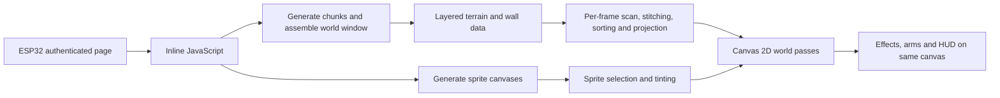
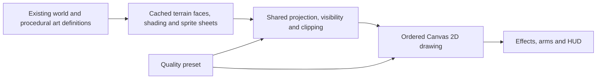

# Visual pipeline investigation and implementation plan

Planning status: 2026-09-19. No game, firmware, renderer, or test-lab code changed by this investigation. Implementation is deferred until the other task's work is ready to integrate.

Target agreed with the user: **modern phones and desktop browsers, with a lightweight quality mode**. The user clarified that they prefer extending the existing Canvas 2D-to-projected-3D approach and keeping one rendering system to maintain. The active plan below follows that preference.

Repository baseline: `8391047d54a44b274ae87e78f16f6c682594f6e4`. Inspected `WebPage_Games.h` SHA-256: `3398802a20f09ac0f2064800d9b51999e3f72fb71b672cbfc8dd18007f0ecd8b`. All source line references below refer to that header unless otherwise stated. Recheck them after the concurrent task finishes.

## Recommendation

Keep the existing **Canvas 2D renderer and its world-to-screen projection**. Improve the shared world data, procedural visual assets, projection, visibility, lighting and drawing efficiency within that pipeline. Quality presets should vary detail, resolution and decorative effects within the same renderer. Changing visual distance independently requires first separating it from the current simulation-distance controls, as detailed below.

The project is not converting a completed 2D picture into 3D. It already contains world coordinates, layered terrain heights, walls, structures, camera projection, and directional sprites. JavaScript projects those into polygons and Canvas 2D draws them. The limiting choices are CPU-side geometry work, thousands of individual drawing commands, approximate visibility, and inconsistent material/lighting rules. A browser may accelerate Canvas 2D internally; the problem is not that every Canvas pixel is necessarily software-rendered.

No second renderer is planned. Visual assets should continue to derive from the same world and procedural definitions, with reusable preparation steps rather than a separately maintained 3D scene. Any later proposal to change the drawing API would require revisiting this decision with the user.

## Evidence and limits

- **Inspected directly:** source for page delivery, initialization, assets, camera projection, terrain, walls, lighting, sprites, effects, UI, quality settings, and chunk assembly.
- **Measured here:** raw embedded-script size and gzip size; calculated sprite pixel storage from the actual creation loops. These are not runtime benchmarks.
- **Inherited evidence:** historical browser/headless measurements in [the existing handoff](game_audit_handoff/HANDOFF.md) and [rendering performance report](game_audit_handoff/evidence/audit_agents/rendering_performance.md). They were not rerun here. The report itself distinguishes command-submission timing from raster-related measurements.
- **Still to verify:** current rendered appearance, mobile frame time, GPU/raster cost, actual device transfer latency, decode time, and thermal behavior. No new browser screenshots or benchmark suite was run during the concurrent test matrix. Aesthetic suggestions below are design proposals based on the rendering code, not a claim that new screenshots were reviewed.

## Current pipeline

Useful existing foundations include centralized biome colors (L360), quality presets (L1180), seeded chunks (L4920), baked static light contributions (L8025), directional enemy frames (L13490/L13887), and per-stage CPU instrumentation (L20500 onward). These should be reused rather than replaced indiscriminately.

## Findings and opportunities

| Area | Source-confirmed behavior | Improvement and expected benefit | Priority / effort |
|---|---|---|---|
| Transfer | One large inline game-script block in the authenticated page (L214; `WebPage_Games.cpp` L12). Inspected page-serving path has no explicit compression/cache policy for this script. | Build a minified, precompressed, versioned static game asset; retain the authenticated page shell. Less repeated transfer and server occupancy. | High / medium |
| Startup art | 384 skeleton canvases plus 64 wolf canvases are built eagerly, including mirrored directions (L13490, L13887, L22510). | Reuse canonical frames with flip metadata; compare a build-time atlas against incremental procedural generation. Faster first interaction and fewer canvas objects. | High / medium |
| Terrain work | Neighbor/layer matching, sorting, projection, color parsing, AO lookup and path fill occur per visible quad (L12457–12926). | Precompute stable topology, numeric colors, normals and AO; cache by chunk; reduce distant polygon density while preserving openings. More frame budget for graphics. | High / medium–large |
| Visibility | Terrain, walls and entity categories render in separate passes; entity occlusion samples a wall depth per screen column (L487, L12013, L18970, L21777). | Improve shared draw ordering, clip sprites against visible wall spans, and test terrain visibility masks in difficult views. These improve specific cases without claiming full per-pixel depth accuracy. | High / medium–large |
| Camera and clipping | Pitch shifts the horizon instead of rotating the view; any rejected quad corner can discard the entire floor polygon (L452, L12756). | Near-plane clipping and consistent projection/aspect conventions in the existing renderer; consider true camera rotation only after aiming parity is tested. Less popping and more natural vertical views. | High / medium–large |
| Fog | Surface floor fog reduces polygon opacity; underground fog darkens color (L12860). Walls use additional, separate rules. | Keep opaque surfaces opaque and mix toward a shared biome/time-of-day fog color. More coherent distance and less background bleed-through. | High / small–medium |
| Quality | Fullscreen entry ignores the resolution setting (L682); resolution applies only through a later fullscreen settings update (L17770). HUD shares the world buffer. | One resize policy for entry, resize, orientation and setting changes; capped pixel budget; separate HUD resolution. Predictable mobile cost with readable UI. | High / medium |
| Chunk transitions | Crossing a chunk boundary synchronously reassembles the window (L7474); many derived arrays are rebuilt. | Coordinate with the other task: boundary hysteresis, chunk reuse, incremental assembly, then worker generation if warranted. Smoother movement. | High / large |
| Animation | Enemy walking is selected from camera distance rather than actual movement (L14070). Arm bob advances once per rendered frame (L15352). | Drive walk phase from distance traveled and action state; use elapsed time for presentation. Feet, attack tells, and hands stay consistent across frame rates. | Medium / small–medium |
| Enemy shading | Dark scenes tint each enemy through a scratch canvas at its projected size; scratch dimensions only grow (L14113). Damage flash fills its entire rectangle (L14136). | Tint at source resolution or through a bounded cache; mask damage flashes to silhouette. Cleaner hits and less screen-sized compositing. | Medium / small–medium |
| Materials | `USE_TEXTURES` is only initialized/toggled; rendering never reads it. The main 3D terrain path fills colors, not texture images (L12872). | Make settings truthful; improve seeded material colors and projected detail. Compare cached texture patches on selected nearby surfaces against their extra Canvas drawing cost. | Medium / medium |
| Light coherence | Light grid stores scalar brightness, despite colored point-light definitions (L8025). Floor uses that scalar; walls approximate warmth; enemies primarily use global ambient. | Share RGB light, fog and material rules; bake static AO; bound dynamic lights. Torches and spells should illuminate nearby surfaces and actors consistently. | Medium / medium–large |
| Effects | Torch glows/ambient particles do not consult wall depth in their draw functions (L15634/L15669). Many spells use runtime blur. | Apply shared visibility checks and clipping to world effects, use reusable glow sprites, and budget particles by projected area as well as count. Fewer effects showing through obstructions and less overdraw. | Medium / medium |

The shared test effort already covers several correctness/performance issues, including cave geometry, fullscreen behavior, window assembly and enemy walk state. Treat those as integration dependencies, not parallel fixes in the same source file.

### Transfer and startup numbers

The current `R"JS(...)JS"` block, including its script markup, is **1,013,814 bytes**. Python gzip level 9 with deterministic timestamp produces **270,209 bytes**, **73.35% smaller**. Historical handoff byte counts differ slightly; these are the fresh counts for the source hash above. At an illustrative effective payload rate of 1 Mbit/s, these bytes alone represent approximately 8.11 versus 2.16 seconds. This is arithmetic, not an observed device loading time; request overhead, radio conditions, browser parsing and generation are additional.

The 448 persistent enemy frames contain **6,963,200 bytes (6.64 MiB)** at four bytes per pixel before canvas/browser overhead. Mirrored construction creates another 168 temporary canvases. Five canonical directions instead of eight reduce retained frame pixels by 37.5% before atlas padding. This is calculated storage, not measured heap/VRAM consumption; an atlas alone does not automatically reduce the underlying pixel count.

Prefer generating reusable sprite sheets from the existing procedural drawing definitions, with flip metadata for mirrored directions. Compare incremental runtime preparation against automatic build-time preparation only if startup measurements warrant it. A build-time version would be generated by the project build, not maintained as a second set of artwork. Avoid rebuilding every mirrored source frame before play is possible.

### Important architectural limitations

- **A column depth is not a 3D depth buffer.** A wall can occupy only part of a screen column; the current single number cannot express what is visible above or below it. A center-point entity test also cannot clip just the hidden portion of a sprite.
- **Drawing categories in a fixed order is not a complete visibility solution.** Sorting within the wall list or enemy list does not establish ordering between terrain, structures, enemies and effects. Blindly grouping Canvas paths by color could make this worse.
- **More pixels do not reduce geometry work.** Lower resolution helps raster/fill cost, but the floor still scans and submits its polygons. View-distance and mesh simplification need separate controls.
- **Pitch and aspect ratio need explicit design.** Horizontal projection derives from canvas width/FOV, vertical projection from canvas height and a separate scale. Validate silhouettes at 3:2, 16:9 and portrait sizes rather than copying these equations into a new renderer without review.
- **Lighting is currently presentation-specific.** The scalar grid has no per-layer light separation or geometry-aware shadowing. Coloring it alone will not stop light leaking between vertically overlapping cave/surface regions.

## Visual direction with a good cost-to-benefit ratio

Proposed style: a cohesive, stylized dark-fantasy world with readable silhouettes, textured low-detail geometry, directional sprite characters, warm local light and cooler distance. This builds on the existing palette, arms and eight-direction enemies; it is a proposal to validate with a small scene.

1. **Make lighting and atmosphere agree.** Consistent fog color, darker contact points, warm torch pools, controlled emissive spell colors and smoother entrance exposure will add depth before increasing geometry. Separate surface and cave ambient by region/layer. Interpolate time-based lighting updates: the current every-five-frames schedule becomes 12 Hz at 60 FPS but only 6 Hz at 30 FPS.
2. **Improve surface identity.** Seeded stone/soil/grass/ice/bark variation, world-anchored detail and consistent colors can break up flat-color terrain. Cache detail where possible and reserve extra drawing for nearby surfaces. Canvas texture mapping can require affine approximations or subdivision, so first compare a small textured wall patch with cheaper projected marks and vertex/face colors; do not assume that texturing every terrain quad is affordable.
3. **Spend detail on silhouettes and landmarks.** Better cave rims, clustered rock shapes, varied tree canopies, and recognizable ruins matter more than evenly increasing mesh resolution. Preserve collision semantics and protect entrances from decoration placement.
4. **Make motion communicate state.** Idle, locomotion, windup, attack, stagger and death should be distinct. Foot placement and ground shadows should follow the actual local floor. Eight directional frames remain viable; fully modeled enemies can be a later choice for close-up needs.
5. **Unify pixel treatment.** Arms explicitly disable image smoothing while enemies use the default in their pass. Decide whether sprites are crisp pixel art or smoothly filtered. Keep UI text crisp independently of the world render scale, and offer reduced camera bob/flash intensity.
6. **Use restrained effects.** Reusable ember/glow/smoke frames, visibility-aware spell trails, short impact marks, and a few prioritized dynamic lights are the initial effects target. Prefer cached glow imagery, baked shading and simple water animation to expensive fullscreen effects. Profile each addition on phones.

## One rendering pipeline

Keep Canvas 2D as the drawing API. The normal and lightweight presets use the same visual definitions, projection helpers and renderer, with different work budgets. Any offscreen sprite/detail canvas is an internal cache owned by that renderer, not an additional service or separately authored scene.

This preserves the current approach while making more of its preparation reusable. A single draw list can improve ordering between categories, but sorting by one distance cannot solve all intersecting geometry. Add clipping or masks for demonstrated visibility failures, and measure their cost before expanding them. A new software rasterizer or full software depth buffer is outside this plan.

A separate HUD canvas, if measurements justify it, would still use Canvas 2D and share the same page and lifecycle. It is optional; keeping UI legible does not require a second world renderer.

## Asset preparation and delivery plan

1. Keep a single authoritative implementation. Any source-file extraction or generated firmware-asset step is optional and should simplify maintenance; preserve the existing lab's extraction/parity checks if its input changes.
2. Give visual assets stable IDs, palette/material definitions, seeded variation, sprite anchors, animation timing, bounds and atlas coordinates. This separates art choices from large drawing functions.
3. Generate sprite sheets from existing art definitions; validate crops, mirrors, alpha and scaled appearance. Include an inspectable contact sheet in the development workflow.
4. Build/cache numeric render data per chunk: positions, topology, colors/material IDs, normals, baked AO and bounds. Keep visual simplification independent from collision data and preserve cave topology.
5. Minify and precompress at build time. Serve a content-versioned asset with explicit content type/encoding and a tested cache policy. If negotiating gzip, vary on `Accept-Encoding`; do not label an otherwise uncompressed streamed HTML page as gzip. Preserve authentication boundaries and avoid shared caching of personalized shell content. See [HTTP compression](https://developer.mozilla.org/en-US/docs/Web/HTTP/Guides/Compression) and [HTTP caching](https://developer.mozilla.org/en-US/docs/Web/HTTP/Guides/Caching).
6. Separate first paint, asset readiness and world readiness. Generate only necessary content first; load or prepare optional visual variants later. Compare asset decode and procedural build costs before choosing either exclusively.
7. Add worker-based chunk preparation only after data ownership is clear. Transfer buffers safely, reject stale results and swap a completed chunk revision atomically. `requestAnimationFrame` deferral alone does not time-slice a long rebuild. OffscreenCanvas can move drawing to a worker, but it does not eliminate drawing work ([MDN OffscreenCanvas](https://developer.mozilla.org/en-US/docs/Web/API/OffscreenCanvas)).

## Phased execution after the other task

### 0. Establish an uncontended baseline

Reconcile the other task's final changes and ownership first. Reuse its validated lab rather than copying known bugs into a second framework. Capture a fixed seed, camera, time of day, animation time and effect state for each representative view:

- daylight terrain, forest, ice and dense structures;
- cave entrance from outside, on the ramp, inside looking in and inside looking out;
- enemy partly hidden by a wall/hill, close-up enemy and a ground effect behind an obstruction;
- heavy combat, a chunk crossing, fullscreen/orientation change, and fixed-level mode if retained.

Use actual Chromium and Safari desktop runs plus iOS Safari and Android Chrome on named devices when available. Browser emulation on this Mac is not mobile GPU/thermal validation. Run performance captures without competing lab processes.

Record navigation/transfer, parse/evaluate, sprite preparation, world assembly and first controllable frame separately. During play record frame-interval distribution, p95/p99 CPU work, missed frames, long tasks, visible geometry/draw counts, memory growth and chunk-transition stalls. The current performance HUD derives its FPS from instrumented CPU work (L20777); that is not a full presentation-rate measurement.

### 1. Portable improvements

Implement independently reviewable changes: coherent resizing, truthful quality controls, opaque color fog, animation timing, source-size sprite tinting and masked damage flash. Align any fullscreen/walk-state fixes with the other task. Reuse canonical sprite directions and evaluate atlas preparation. Add static delivery compression after verifying firmware build/route behavior.

Keep changes only when screenshot comparisons improve or preserve the intended look and the relevant metric improves without meaningful regressions. Each change extends the existing renderer; it should not introduce a duplicate visual implementation.

### 2. Improve one representative Canvas scene

Use one representative surface/cave scene with existing generated data, walls/ceiling, one directional enemy, a torch and a spell effect. Improve shared projection/clipping, fog, material colors, local lighting and the known overlap cases within Canvas 2D. Include the difficult entrance view in the first comparison, not just flat terrain.

Measure it against the baseline at the same camera and output resolution. Compare partial sprite occlusion, near-plane behavior, material readability and lighting consistency. Treat optional texture patches as a separate experiment so their added cost is visible. Preserve the world/collision data and verify entrance views against the other task's fixes.

### 3. Scale and polish

Expand to cached chunk render data, stable chunk-boundary vertices, visibility bounds, distance-based simplification and reusable sprite/effect imagery. Simplify distant visual geometry without closing openings, changing collision or creating cracks. Move preparation off the main thread only where measured stalls justify the ownership complexity.

Add visual features in order: material variation and baked contact shading, local colored light, improved enemy states, vegetation/landmarks, then affordable cached effects. Measure each addition against the same scenes.

## Proposed success criteria

These are targets to calibrate on the chosen devices, not promised benchmark results.

| Metric | Acceptance direction |
|---|---|
| Main quality mode | Aim for sustained 60 FPS (16.7 ms frame budget) on the chosen modern phone and desktop targets; reserve time for simulation/browser work |
| Lightweight preset | Predictable 30 FPS target (33.3 ms budget), reduced distance/effects/pixel count and legible HUD within the same renderer |
| Frame pacing | Report p95/p99 and crossing spikes; no routine generation task longer than 50 ms on the main thread, with a stricter per-frame work budget for smooth play |
| Loading | Confirm compression savings in actual transferred bytes; measure cold and warm first-controllable-frame time on the ESP32 link |
| Memory | Stable after repeated travel and quality changes; bounded render-data caches, sprite sheets and scratch surfaces |
| Visual correctness | No new entrance holes, ground bleed-through, whole-sprite occlusion pops, rectangular hit flashes or clipping regressions in the reference scenes |
| Mobile | Check touch/UI readability, orientation, pause/resume and a sustained session of at least ten minutes for thermal degradation |
| Compatibility | One tested Canvas 2D renderer across normal and lightweight settings; no extra cloud service required |

## Implementation design, difficulty and downstream impact

This expanded analysis traces implementation boundaries in the unchanged source. Difficulty includes integration and verification, not just the size of an edit: **1 = localized change; 2 = several connected functions; 3 = shared lifecycle or multiple consumers; 4 = geometry or substantial data preparation; 5 = broad visibility, camera or world-state work.** These are relative estimates, not measured development times or promised frame-rate gains.

### Ranking

| ID | Change | Difficulty | Likely benefit | Main downstream dependency |
|---|---|---:|---|---|
| V02 | Mask enemy hit flashes; tint at source size | 1–2 | Cleaner sprites; less compositing at large on-screen sizes | Canvas alpha/state and sprite draw consumers |
| V01 | Make fullscreen honor resolution consistently | 2 | Reliable quality/performance tradeoff | Overview sizing, input coordinates, context reset |
| V04 | Predecode terrain colors; cache static shading inputs | 2 initially | Less repeated CPU work | Layer finalization, fixed-level data, debug colors |
| V05 | Reuse glow images instead of recreating blur/gradients | 2 | Cheaper repeat effects | Blend mode, clipping and effect bounds |
| V03 | Frame-independent hands and movement-driven enemy gait | 2 for hands; 3 for enemies | Stable motion and better combat readability | Pause behavior, knockback, entity reconstruction |
| V06 | Canonical sprite frames and generated sprite sheets | 3 | Less startup work and fewer canvas objects | 2D/3D/debug drawing, readiness, test observation |
| V07 | Shared fog and atmospheric colors | 3 | More coherent depth and distance | All opaque passes, entrance transitions, sky/background |
| V08 | Stable procedural material variation | 3 | Better surface identity without dense textures | Absolute coordinates, visual RNG, chunk revisions |
| V15 | Automatic precompressed game asset delivery | 3 | Strong measured transfer-size opportunity | Firmware build, authenticated route, extraction tests |
| V09 | Consistent colored local lighting | 4 | Larger visual improvement around torches/spells | Layer separation, memory, light update cadence |
| V10 | Precompute terrain faces and neighbor matching | 4 | Reduce repeated geometry work | Finalized layers, neighbor borders, invalidation |
| V11 | Proper clipping at the camera's near plane | 4 | Less popping when approaching geometry | Every geometry path and wall visibility spans |
| V12 | Partial sprite occlusion and cross-category ordering | 5 | More believable walls, hills and cave views | Depth convention, multiple spans, overlapping surfaces |
| V13 | Merge/simplify distant terrain | 5 | Reduce actual polygon submissions | Cave topology, seams, visual/collision agreement |
| V14 | True camera pitch and unified perspective | 5 | More natural vertical views and aspect handling | Aiming, spell trajectories, crosshair, arms and all projections |
| V16 | Incremental/worker-based world assembly | 5 | Reduce crossing stalls | Entity persistence, coordinate rebasing, atomic state publication |

The best starting value is V01/V02/V04/V05, followed by V03/V07/V08. V10 is the larger optimization worth evaluating before spending time on extensive texture mapping. V12–V14 and V16 should be separate projects within the same codebase, each with a narrow first milestone; they are not prerequisites for visible improvements.

### Couplings that change the implementation order

**Render distance currently changes simulation.** `updateEnemies()` uses `viewDist * 1.5` as its update radius (L11347), and `separateEnemies()` uses the same multiplier (L19236). The quality presets also alter `WINDOW_CHUNKS`, which controls assembled terrain, entity lists and eviction, not just pixels. An automatic quality controller must initially adjust render resolution and decorative effects only. A later change should introduce distinct visual and simulation radii with an explicit simulation baseline and regression checks. Merely renaming `viewDist` would not separate their behavior.

**Changing frame rate can currently change input behavior.** `loop()` calls `handleInput(FIXED_DT)` once per rendered frame (L21910) while physics advances in fixed steps. The shared audit already covers that coupling. Integrate its correction before judging how a visual optimization changes movement/turning at 30 versus 60 FPS. Otherwise an apparently faster renderer could also make controls behave differently. Keep this under the other task's ownership rather than quietly fixing input in a graphics patch.

**Window assembly is also a world-state transition.** `assembleWindow()` saves enemy/chest/spawner deltas, changes the origin, adds and sorts cave caps, rebuilds entity objects, rebases projectiles/effects and rebuilds lighting/minimap data (L6324, L6700, L6993, L7289). Cached visual data must refer to the completed revision. A worker cannot safely mutate these globals incrementally while the current frame reads them.

**The lab currently recognizes implementation details.** The enemy animation probe identifies frames by canvas object identity (`game_render_harness.js` L672). Sprite-sheet frames share one canvas, so that observer would stop distinguishing animations. The source extractor expects the game in one `R"JS"` region with a constant source-line offset (`game_lab.py` L62). Asset extraction and compression need shipped-content parity checks so an empty/stale source extraction cannot produce misleading success.

**Headless canvas calls do not prove pixels.** `_game_env.js` L207 implements transforms and clipping as no-ops, returns zeroed image data, and counts save/restore depth without restoring a full drawing state stack. Keep these tests for logic and submitted geometry, but use real-browser comparisons for masks, mirroring, resizing, fog and clipping. Update known-bug expectations only after the corresponding behavior is actually fixed; do not simply delete a newly failing observer.

### V01 — Resolution and resizing

Implementation: introduce one internal sizing helper called by fullscreen entry/exit and settings application. First preserve current embedded-size behavior and the current perspective math. Calculate the chosen fullscreen buffer size from the viewport and resolution setting; only assign width/height when the dimensions change. Restore explicit smoothing/compositing defaults after a resize. Continue deriving projection and HUD scaling from the resulting buffer dimensions.

Downstream: `toggleOverview()` independently saves/restores width, height and CSS size (L18787), so overview must own sizing while active; on exit, recompute the latest game size rather than restoring stale pre-rotation dimensions. Settings clicks already convert client coordinates into canvas coordinates (L22218); keep that mapping and test the rightmost/bottommost controls. Wall depth storage resizes with width (L11791). A future overlay would also require moving fullscreen to a common container and reviewing pointer-lock targets, which is why it is not part of this first fix.

Changing canvas width resets its drawing state even when the same width is assigned, so repeated resizing is not a harmless per-frame operation ([MDN canvas width](https://developer.mozilla.org/en-US/docs/Web/API/HTMLCanvasElement/width)). Do not automatically multiply every resolution by full device-pixel ratio: that can undo the mobile pixel budget. Validate size/state transitions and real browser input; adaptive resolution comes later, with slow adjustments and hysteresis to avoid oscillation.

### V02/V05 — Sprite compositing and reusable effects

Implementation: factor an internal sprite preparation helper out of `drawEnemies3D()` (L14113). Copy the selected sprite into a reusable scratch surface at its source dimensions, apply ambient tint and hit color through the sprite's alpha, then scale that result into the screen rectangle. The original procedural sprite stays immutable. The scratch storage remains bounded by source dimensions instead of the largest close-up enemy seen so far. Apply explicit state on every call and restore the main context afterward.

For V05, generate a few small radial glow images once, indexed by spell/light palette. Scale and fade these images per effect. Keep animated shapes, timing and gameplay hit areas as they are. Do not cache whole rendered screen patches; those would become stale when the camera moves. Add a bounded cache only if measurements show preparation is still material; include sprite identity/frame, lighting bucket and flash color in its key.

Downstream: transparent borders must stay transparent, successive enemies must not inherit each other's tint, and blur imagery may need padding to avoid cropped edges. Additive torch blending differs from ordinary sprite blending. Enlarging an image does not make overdraw free, and this change alone does not stop glows showing through walls. Compare daylight/night, close-up sprites, overlapping effects and hit frames in a browser. The first patch is V02 alone; V05 is independently removable if its blur quality is poor.

### V03 — Animation follows movement and time

Implementation for hands: move phase advancement out of `drawFPSArms()` into a presentation update that receives elapsed time once per frame, with a zero delta when the relevant gameplay is paused and a bounded delta after tab resume. Normalize to the current 60 FPS appearance initially. Drawing the same state twice should produce the same pose.

Enemy implementation is more involved: accumulate actual locomotion distance after movement/collision resolution, and select the walk frame from that distance. Do not use `e.vx/e.vy` as walking speed: `updateEnemies()` uses those fields for knockback, while chase/patrol motion edits positions directly (L11361, L11439). Distinguish voluntary walking from sliding/knockback and attack windup. Sample simulation movement even when an enemy is offscreen so visibility does not control animation state.

Downstream: positions rebase and enemy objects are recreated at chunk shifts. Carry optional visual phase through the existing save/recreate path, or deliberately reset it without treating a window shift/teleport as distance walked. Do not add a new persistence system just for animation. Attack timers and damage stay under the existing gameplay state machine; new poses reflect those timings. Test idle, blocked walking, slow/stun, knockback, chunk shifts, menu pause and 30/60/120 Hz presentation. Extend the current animation observer to inspect the selected frame/source rectangle rather than relying exclusively on canvas identity.

### V04/V08 — Numeric colors and stable material detail

Implementation: add derived packed-color arrays after all layer colors are finalized. Initially leave the existing string arrays intact for the minimap, overview and other consumers. Replace the floor/ceiling pass's repeated `parseInt` with numeric reads. Precompute static wall-neighbor AO and material variation in the same lifecycle, while leaving daylight, distance fog and dynamic light calculations live. Debug layer/poly colors remain an explicit draw-time override.

Downstream: building this cache during raw chunk generation would miss window-level cap creation and layer sorting (L6700–6754). Fixed levels construct different data (L2477–2580) and have an existing missing-layer-color problem; a numeric cache must not silently turn missing data into black and hide that failure. Wait for the other task's resolution of that path. Five full `Uint32Array` color layers at the current 7×7 window size add approximately 1.50 MiB, so measure memory as well as CPU savings and consider storing only active face colors when V10 is available.

V08 should use a stateless hash of world seed, absolute cell coordinates, layer/material identity and a visual-purpose tag. Do not consume the existing gameplay/generation random stream for extra speckles; that could change later placement or loot. Window-local hashes would make the same rock change appearance as the window moves. Start with color/slope variation that adds no draw calls; only add projected cracks/grass accents within a limited near range. For a cosmetic-only patch, compare world/entity state before and after, revisit the same location across a chunk shift, and confirm that debug colors still work.

### V06 — Sprite preparation without a second art system

Implementation: introduce a frame accessor returning an image, source rectangle, anchor and flip flag. Update the 3D enemy pass, 2D mode (L18835), and skeleton debug view (L13917) to use it before changing storage. Then generate five canonical directions instead of eight and use flip metadata for the other three. Only after that change passes should frames be packed into generated sheet pages.

Downstream: mirrored anchors, shadows and status effects must remain aligned. A sprite sheet is fewer objects, not automatically fewer bytes or drawing calls; padding can increase pixel storage. Do not generate a separate large sheet for every tint. Incremental generation needs explicit readiness so Start cannot select an unavailable frame; start with the required idle/visible assets and ensure restart cannot launch duplicate builders. For the first milestone, keep startup synchronous and change only canonical storage/access; measure whether further startup scheduling is needed. Check every type/direction/damage variant with a contact sheet and update the identity-based test observer.

### V07 — Fog is a material rule, not transparency

Implementation: compute one per-frame atmosphere description from biome and time of day, including surface fog color, cave fog color, start/end distances and background colors. For an opaque surface, mix its lit RGB toward the applicable fog RGB and draw at alpha 1. Keep actual transparency for smoke/glow and alpha edges of sprites. Migrate floor, walls, ceiling and opaque structures together in one representative scene so different fading rules do not produce obvious seams.

Downstream: use the surface's cave/surface role where possible; a single player-underground boolean can recolor an entire mixed entrance view abruptly. The final fog color must agree with the horizon/ground background or the far distance will end in a visible ring. Hidden surfaces accidentally painted in the wrong order may become more obvious once opaque; this is not a reason to restore transparency to solid rock. Retain existing cave-correctness checks and add pixel comparisons for outside-to-inside and inside-to-outside views at several times of day. Keep this separate from RGB dynamic lighting so either result can be judged independently.

### V09 — Colored lighting

Implementation: start with a shared light-sampling contract used by floor, walls and enemies. Preserve the current scalar result first to establish parity, then extend the baked contribution to RGB. Use time-based flicker and interpolate a modest update rate, rather than the current every-five-rendered-frames cadence. Prioritize a small number of nearby dynamic lights and update only their affected regions.

Downstream: three channels require more storage/update bandwidth than one. The current light grid is two-dimensional, so vertically overlapping cave/surface floors cannot safely share one unqualified sample. Keep region/layer identity in the sampler and first separate cave and surface contributions; true wall-aware shadows are a further task. Enemy tint caching must include lighting state and remain bounded. Darkening enemies also changes combat readability even if damage logic is untouched. The first acceptance scene is one torch with ground, wall and enemy at the same location, followed by a cave under a lit surface and a light moving across cell boundaries.

### V10 — Cache actual terrain faces

Implementation: after world geometry is finalized, derive compact face records with resolved corner indices/heights, layer role, material/color, static AO and bounds. Initially cache at the assembled-window level and rebuild on a geometry revision; this is easier to verify than immediate independent per-chunk ownership. Keep the same visible-face selection and order for the first version. Move repeated layer matching out of `drawLayersFloor3D()`/`drawLayersCeiling3D()` without changing its meaning.

Downstream: the floor's matching tolerance/clamping and ceiling's different matching rule are not interchangeable (L12701 versus L13002). Neighboring chunks supply border corners. Store which generation/revision and neighboring borders a cache was built against; invalidate when they change, not just when the world seed changes. Keep camera-facing tests, entrance visibility and distance fog live. More precomputation can increase startup and crossing stalls even while steady-state frames get faster. Measure both, along with allocated bytes. Compare resulting world-space faces in unchanged scenes and retain a bounded cache lifetime. Independent chunk caches are a later step once this version demonstrates a worthwhile gain.

### V11 — Near-plane clipping

Implementation: project world vertices into camera coordinates first, then clip each polygon against a positive forward-distance plane before perspective division. Reuse scratch vertex buffers; a clipped quad may have a different vertex count. Use the same plane convention across floors, ceilings, walls and structures. Replace coarse rejection of a polygon merely because one corner is behind the camera or outside a screen margin with conservative bounds and actual clipping.

Downstream: preserve each path's existing height units before attempting any unit cleanup. Wall depth spans must be generated from the clipped polygon, not the original corners. Cave arch decorations and generated cliff skirts need the same treatment or seams remain. Existing headless quad counters may see different vertex counts; the requirement is correct coverage without huge/NaN coordinates, not always four vertices. Use a controlled camera sweep through a wall edge, floor tile and entrance at fixed heights. Keep the current pitch model during this work so projection and clipping changes can be evaluated separately.

### V12 — Partial hiding and draw ordering

Implementation: begin with a specific wall/enemy case. Record the wall's projected top/bottom bounds and depth over its covered columns; compare those spans with the sprite's depth to construct a clipped visible region. Remove the current all-or-nothing center-column rejection for sprites handled by that path. Use one clip region composed of surviving spans where practical, rather than hundreds of separate one-pixel sprite draws. Adapt effects only after the enemy case works.

Downstream: a nearest wall value for an entire column cannot represent two walls at different heights; multiple depth/vertical spans may be necessary. Sloping wall depth must vary correctly across the screen. Hills require terrain occluders as well as walls. Structures and sprites still need cross-category ordering, and interpenetrating polygons may require splitting rather than one global distance sort. Masks/clips add CPU and raster work, so cap complexity and measure it. Do not carry a stale visibility buffer when a pass is skipped or debug-hidden. This is the hardest rendering-specific item because it addresses several geometric cases, not one draw-order bug. The first acceptance is a sprite progressively emerging around a wall, not a claim to solve every cave view.

### V13/V14 — Distant geometry and true pitch

For V13, first merge only compatible, nearly coplanar distant surface cells with the same material and no entrance, layer transition, water edge or cliff. Preserve shared border vertices and prohibit merging across holes. Switch detail using a stable threshold with hysteresis. Physics continues using the authoritative full-resolution data. Downstream risks are cracks, blocked-looking cave openings, flattened silhouettes and visible popping; alpha crossfades of solid terrain also reintroduce transparency/overdraw. This can reduce polygon fills, but an unrestricted simplifier is a major geometry task.

For V14, first inventory and consolidate projection conventions without changing the result. A later true pitch rotation must be coordinated with `spawnProjectile()` (L10483), `spawnLobProjectile()` (L10521), the pitch-shifted crosshair (L21810), hand/orb placement, sky/horizon, billboard sizing and input modes. Current shots already use trigonometric pitch while the view uses a horizon shift. Camera-only replacement could change apparent aim. Validate center/edge aim on near/far targets, upward/downward shots and aspect ratios. This is optional for the initial visual upgrade and should not be bundled into clipping or fullscreen sizing.

Broad perspective texture mapping is similarly expensive: Canvas transforms are affine ([MDN transform](https://developer.mozilla.org/en-US/docs/Web/API/CanvasRenderingContext2D/transform)). Approximating a perspective surface with clipped textured triangles or strips requires extra subdivisions where distortion is high. A near wall patch can be a medium-sized experiment; applying it across thousands of terrain tiles is difficulty 5 with uncertain performance benefit. Begin with V08's cheaper material identity improvements.

### V15 — Compression and caching integrated into the normal build

Implementation: use the existing readable game source as the only authority and have a deterministic build step extract the JS body and produce compressed firmware data. Serve it through a versioned game-asset route under the existing device server; the authenticated shell loads that asset in the correct order after shared dependencies. No CDN, new server or manual art-copying step is required. Keep minification as a separate follow-up to avoid adding another toolchain requirement in the first compression change.

Downstream: generate on source changes, not only on clean builds; fail the build on stale/missing assets. Verify that decompression produces the expected shipping JS, update the standalone browser page and source-extraction assumptions, and retain actionable source diagnostics. The new route needs the correct MIME/encoding, version/cache behavior, existing authentication policy, and binary-safe length handling. Flash savings depend on not accidentally embedding both full uncompressed and compressed copies; measure the firmware image. Test device cold/warm loads, firmware version changes, auth expiry and transfer interruptions. The earlier 73% size reduction is real for the measured input; end-to-end load improvement is still unmeasured.

### V16 — Streaming without corrupting state

Implementation should start with the other task's world-assembly fixes and a conservative hysteresis threshold supported by a sufficient loaded-area margin. Next separate immutable terrain preparation from live entity and origin updates. Prepare a pending revision completely, reject stale results, then publish it at a controlled update boundary and apply coordinate shifts once. Move only pure generation/preparation to a worker if main-thread stalls still justify it.

Downstream: a delayed result can belong to an old seed, quality setting or player location. Entities can die, chests can open and projectiles can move while preparation runs, so those live deltas cannot be overwritten with an old snapshot. Transferring an active typed-array buffer to a worker would detach it from its current owner; use a defined ownership/swap protocol. Rapid boundary crossings and settings changes can queue redundant jobs. This is world-state engineering with a visual benefit, and is the most invasive performance item in the plan.

### Shared contracts and implementation order

The following are proposed internal helpers/data, not implemented APIs:

| Contract | Owned data | When it changes |
|---|---|---|
| Render sizing | Display dimensions, chosen buffer size, context defaults | Fullscreen, viewport, quality or overview transition |
| Visual frame state | Camera snapshot, visual time, atmosphere | Once after camera/update state is ready; never accumulated by drawing twice |
| Sprite frame descriptor | Source image/rectangle, anchor, flip | Asset build or type/frame selection |
| Terrain render cache | Resolved faces, numeric colors, static AO, revision | Finalized geometry changes; neighbor-border changes for chunk caches |
| Visibility scratch data | Projected occluder spans and frame stamp | Rebuilt per frame and reset on resize/pass omission |

Add each contract only when its corresponding change needs it. Avoid a large preliminary rewrite of the 22,000-line game file.

Recommended sequence after the other task settles:

1. Establish baseline scenes and metrics; reconcile overlapping fixes and known-bug expectations.
2. Make separate small patches for V02, V01, V04 and V05. Judge both appearance and cost.
3. Implement V03, then V07/V08 for visible polish. Consider V15 independently for load time.
4. Evaluate V10's steady-frame benefit against its preparation/memory cost, then V09 and V11 as separate changes.
5. Attempt V12/V13 only if the remaining artifacts or polygon cost justify them. Leave V14 and V16 optional until their specific benefit is demonstrated.

For every patch, record the same seed/view/quality, relevant frame-time or startup measurement, browser screenshots where pixels change, and any intended behavior change. Verify that cosmetic changes leave game state unchanged for the same input sequence. A performance optimization is not accepted solely because its average FPS rises if it worsens crossing stalls, memory growth, input response or gameplay behavior.

## Handoff status

Investigation and planning only. This note is the sole project file created by this task; it is not staged or committed. Existing handoff/lab material belongs to the other task and was not modified. No monitoring automation or implementation was scheduled. The user's clarification replaces the earlier WebGL-plus-fallback recommendation with an extension of the existing Canvas pipeline. Next work is baseline visual capture and a measured Canvas improvement after the user resumes implementation and the concurrent work is reconciled.
